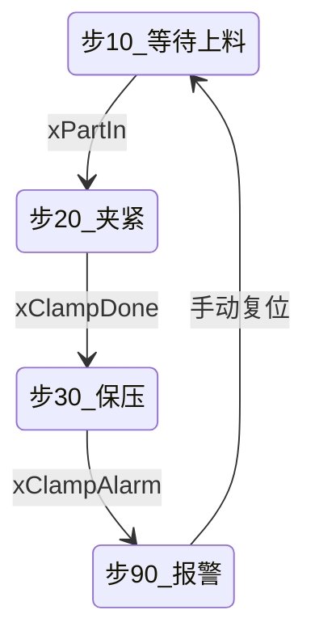

# 手册样例：夹紧工位（节选） 📘

> 历史2.x兼容样例：保留原稿供回归，不作为新稿格式。当前默认使用[块级手册样例](example-block-handbook.md)，正文不重复逐行注释。

> 本文件仅为结构示范，变量、步号和对象名均为虚构示例，不代表任何真实工程事实。

## 目录

- [一、工程与边界](#ch1)｜[二、执行框架](#ch2)｜[三、工艺主线](#ch3)
- [四、工位地图与段分类](#ch4)｜[五、模块详解](#ch5)
- [六、段间与工位间逻辑关系](#ch6)｜[七、关键 MFB/FB](#ch7)
- [八、异常、报警与恢复](#ch8)｜[九、未确认与证据](#ch9)｜[十、理解检验与审查](#ch10)

> 文档类型：handbook | 深度：代码深度
> 模板组合：HBK@2.2 + STATE@2.1 + FLOW@2.2
> 适用章节：ch1, ch2, ch3, ch4, ch5, ch6, ch7, ch8, ch9, ch10
> 交付范围：局部
> 本次覆盖：示例工位 SR_W01 的 M02 可见源码与可确认关系；M03 仅保留资料摘要
> 本次交付：完成
> 项目源码覆盖：部分覆盖
> 用户理解：未自测
> 工程：示例夹紧站 | 控制器：<示例控制器> | 版本：V1.0 | `source_sha256`：示例
> 源码语言：ST | 覆盖对象：工位 POU `SR_W01`（4 个模块） | 资料范围：导出文本

<a id="ch1"></a>

## 一、工程与边界 📋

- 任务：`MainTask`（1 ms，定周期）
- 程序组织：`MainTask` → 公共条件 POU → 工位 POU `SR_W01` → 报警 POU `SR_Alarm`
- 资料范围：本节选仅展示 M02 源码；M01/M04 未提供，M03 只有摘要；`SR_Alarm` 受保护，仅可读接口
- 本手册不覆盖：HMI 画面、伺服参数、安全回路硬件

<a id="ch2"></a>

## 二、执行框架 ⚙️

```text
MainTask（1ms）
→ SR_Common  公共条件与模式切换
→ SR_W01     工位 1（M01 映射 → M02 自动 → M03 监视 → M04 报警）
→ SR_Alarm   报警汇总（受保护）
```

整体功能：完成工件夹紧与保压监视，向加工工位输出夹紧完成许可。

<a id="ch3"></a>

## 三、工艺主线 🏭

| 步 | 工序 | 进入条件 | 执行元件 | 完成信号 | 退出 | 工位/证据 |
|---|---|---|---|---|---|---|
| 10 | 等待上料 | 自动模式且无报警 | — | `xPartIn` | 步 20 | 工位 1 / M01 |
| 20 | 夹紧 | 步 10 完成且 `xPartIn` | `yClampValve` | `xClampDone` | 步 30 | 工位 1 / M02 |
| 30 | 保压监视 | 步 20 完成 | — | `xClampDone` 保持 | 超时转报警 | 工位 1 / M03 |
| 90 | 报警处理 | 任一报警位置位 | 清除输出 | 手动复位 | 步 10 | 工位 1 / M04 |



- 图中四个节点与上表步号一一对应；无并行分支或并发合流。
- 节拍：夹紧与加工许可握手并行执行，节拍由夹紧行程时间约束。
- 手动/回原点：手动夹紧经 `xManualClamp` 直接驱动，不经过步序。
- 安全与联锁边界：安全门断开 `yClampValve` 由硬件回路实现，程序互锁为第二层保护。

<a id="ch4"></a>

## 四、工位地图与段分类 🗂️

| 工位 | POU | 职责 | 段落构成 | 段数 | 覆盖状态 |
|---|---|---|---|---|---|
| 工位 1 夹紧站 | `SR_W01` | 工件夹紧、到位判定与保压监视 | 映射段、自动段、监视段、报警段 | 4 | 部分覆盖 |

- 段分类采用工程实际命名；本工位无独立通讯段与参数段。
- `SR_Alarm` 为跨工位共用 POU，受保护，仅登记不展开。

<a id="ch5"></a>

## 五、模块详解

### 模块跳转

| 模块 | 说明 |
|---|---|
| [M02 夹紧控制](#m02) | 步序 20 夹紧、到位推进 |
| [M03 保压监视](#m03) | 步序 30 超时监视 |

**对象总述**：`SR_W01` 是夹紧工位 POU，接收上料与模式信号，输出夹紧阀及到位许可。

- 输入：`xPartIn`、`xAutoMode`、`xClampDone`。
- 输出：`yClampValve`、`xClampDone`（供后续工位读取）。
- 调用条件：由 `MainTask` 周期调用；报警 POU 在其后读取异常状态。
- 控制闭环：步 20 夹紧、到位推进步 30、持续监视到位状态。

### W01 夹紧站

**职责**：在自动模式且工件到位时执行夹紧，判定夹紧到位后输出加工许可，并对保压过程实施超时监视。

1. **进入条件：** 自动模式且工件到位（`xAutoMode`、`xPartIn`）；条件不满足时不启动夹紧。
2. **夹紧与到位：** 置位 `yClampValve`，检测 `xClampDone`；到位后步序由 20 推进至 30。
3. **保压监视：** 在步 30 监视到位状态；超时则置位 `xClampAlarm`，具体阈值以定时器设定为准。
4. **报警结果：** 示例工程假设 M04 清除 `yClampValve` 并复位步序；本例未展示 M04 源码，复位条件未知。

**本工位源码块覆盖清单**

| 编号 | 模块 / 段 | 对象 ID | 范围（行/网络） | 覆盖状态 | 备注 |
|---|---|---|---|---|---|
| M02 | 夹紧控制 | obj2 | 示例可见 6 行 | 已讲 | 本次范围 |

<a id="m02"></a>

#### M02 夹紧控制

**职责**：在步号 20 且工件在位时驱动夹紧阀，检测到位后推进步序；当前片段未显示步 20 等待到位的超时保护，不能用只在步 30 使能的 M03 代替。

1. **进入条件：** `iStep` = 20 且 `xPartIn` 为 TRUE；否则保持当前步序。
2. **输出动作：** 置位 `yClampValve`，等待 `xClampDone` 到位反馈。
3. **状态变化：** 到位后 `iStep` 由 20 推进至 30；未到位时留在步 20。本例 M03 只监视步 30，步 20 超时路径仍未知。
4. **同一程序内部关系：** 向 M03 提供步 30 与到位状态；M04 清除 `yClampValve` 属示例工程假设，源码未展示。这些关系在第六章展开，不称为其他程序交互。

**1. 功能定位**

本假想教学模块要解释：如何只在当前工序请求夹紧，并等到反馈才推进。已知 `iStep` 记住跨扫描所处的工序，因此用 `iStep = 20` 限制这段写入；`xPartIn` 表示工件在位，`xClampDone` 表示到位反馈，请求和反馈不能相互替代，所以外层用工件在位约束请求，内层用反馈约束推进。这里的工艺目标是示例设定，不能据此断言用户工程的原作者意图；只由可见代码核对条件与写入。

- 功能定义：在步号 20 且工件在位时驱动夹紧阀，检测到位后推进至步 30。
- 输入：`iStep`（来自 M01 步序推进）、`xPartIn`（M01 映射）、`xClampDone`（现场到位传感器）。
- 输出：`yClampValve`（夹紧阀输出；示例工程假设由 M04 清除，当前未展示其源码）、`iStep`（推进至 30，供 M03 使用）。
- 工艺位置：对应工序步 20“夹紧”。
- 关联模块：M01 提供进入条件；[M03](#m03) 监视步 30；M04 复位输出属于示例工程假设，当前未展示其源码。
- 条件不满足时：本段不改步号或输出，保留原值；不能一概说步号为 20，也不能认定会由 M03 超时处理。

**2. 推演示例**

目标是步号 20 且工件到位时请求夹紧，到位反馈成立后将步号推进到 30。下例只演示可见的 M02 逻辑，不推断现场气路或 M04 的清除行为。

| 场景 | 初始状态 | 输入序列与扫描过程 | 预期结果与依据 |
|---|---|---|---|
| 正常 | 假设扫描开始时 `iStep = 20`、`yClampValve = FALSE`、`xPartIn = TRUE`、`xClampDone = FALSE` | 第 1 次扫描反馈仍为 FALSE；第 2 次扫描前 `xClampDone` 变为 TRUE | 第 1 次扫描写入阀 TRUE、步号仍为 20；第 2 次扫描再次写入阀 TRUE，并把步号写为 30。结果由外层条件、阀赋值及内层到位条件依次推出。 |
| 边界 | 假设 `iStep = 20`、`xPartIn = TRUE`、`xClampDone = FALSE` | 连续 3 次扫描反馈均为 FALSE | 每次都进入外层条件并写阀 TRUE，内层条件为假所以步号保持 20。M02 未显示步 20 超时逻辑，不能从这段代码推出报警。 |

**3. 实现与逐句说明**

问题是如何在正确步序和工件到位条件下发出夹紧请求，并在确认到位后推进步序。可见输入为 `iStep`、`xPartIn`、`xClampDone`；可见写入为 `yClampValve` 与 `iStep`。约束是只有外层条件成立才执行两项动作；源码不显示输出清除、超时保护或 M03 的任务顺序，这些保持未知。

<!-- src: none；来源/对象：SR_W01/M02（虚构示例，无真实源坐标） -->

```pascal
IF iStep = 20 AND xPartIn THEN        // 步序 20 且工件到位，才允许本段请求夹紧 // AI: 检查夹紧步号与工件到位条件
    yClampValve := TRUE;              // 本段置位夹紧阀输出，清除条件未出现在当前源码 // AI: 置位夹紧阀输出请求
    IF xClampDone THEN                // 到位反馈出现后，推进到保压监视步 // AI: 检查夹紧到位反馈是否成立
        iStep := 30;                  // 新步号可被本扫描后续逻辑立即读取，M03 是否在其后执行仍需任务顺序证据 // AI: 将当前步号推进到保压监视步
    END_IF; // AI: 夹紧到位后的步号更新范围结束
END_IF; // AI: 夹紧步动作范围结束
```

**逐句看**

- `IF iStep = 20 AND xPartIn`：读取当前步号和工件到位输入；两者都为 TRUE 时进入动作块，任一为 FALSE 时跳过阀写入和到位判断，两个值及输出保持原值。
- `yClampValve := TRUE`：进入动作块后把输出变量写为 TRUE；每次扫描条件成立都会执行这次赋值。此源码没有清零语句，输出如何清除需查其他写入点。
- `IF xClampDone`：读取到位反馈；为 TRUE 才进入步号更新，为 FALSE 时跳过赋值，步号保留扫描前的值。
- `iStep := 30`：反馈为 TRUE 时将步号写成 30；同一扫描后续逻辑可读到新值，但 M03 是否随后执行需要任务顺序证据。

**状态后果与边界**

- 正常例中，第 1 次扫描结束为 `yClampValve = TRUE`、`iStep = 20`；第 2 次扫描反馈变 TRUE 后结束为 `yClampValve = TRUE`、`iStep = 30`。M02 不会因步号推进而自动清除输出。
- 外层条件不成立时，本块没有写入，变量保持扫描前值；因此不能把“当前步不是 20”解释为输出已复位。
- 若其他模块也写 `yClampValve`，最终值还受其执行顺序和赋值影响；当前资料未提供足以确认顺序的证据。
- 检查：若移除 `AND xPartIn`，哪些步 20 情况会新增阀输出写入？

**形象理解**

可以把它想成夹具操作员的流程卡：到“夹紧”步骤且工件已经放好，才按下夹紧按钮；传感器确认夹紧到位后，流程卡翻到“保压”步骤。`iStep` 像流程卡页码，`yClampValve` 是夹紧指令，`xClampDone` 是到位确认。类比不包含实际气路、机械力或安全回路的实现，这些必须以设备图纸和程序证据为准。

**变量怎么变**

- 外层条件成立时将 `yClampValve` 写为 TRUE，旧值未给出，不一定发生 FALSE→TRUE 边沿；`xClampDone` 为 TRUE 时，`iStep` 由 20 变为 30。
- `xClampDone` 未成立时，步号留在 20；输出复位点未知，需核对 M04 和回原点源码。

**行为依据与风险**

- 以步号限定动作阶段，减少其他流程阶段误触发夹紧的机会。
- 本段只置位输出，不负责复位；M04 是否覆盖异常/退出路径未知，若未覆盖则输出可能残留。
- 易混淆：步号推进至 30 不代表夹紧阀自动关闭。

**4. 与其他程序的交互**

当前资料未确认与其他程序之间存在调用、信号、状态或通讯交互；`xClampDone` 的跨工位关系以及 M02/M03/M04 的同一程序内部关系统一见第六章，不将内部程序关系误称为其他程序交互。

<a id="m03"></a>

#### M03 保压监视（摘要）

**职责**：在步 30 期间监视 `xClampDone` 是否保持，超出设定时间置 `xClampAlarm`；示例工程假设 M04 处理该报警，相关源码未展示。

1. **监视条件：** 步序为 30 时使能定时器。
2. **超时处理：** 超过设定时间置位 `xClampAlarm`；示例工程假设 M04 据此清除夹紧输出，M04 源码与处理条件未知。
3. **定时器复位：** 现有摘要不能确认退出步 30 后 `IN` 是否复位；具体设定值和调用位置也须查 M03 源码。

**1. 功能定位**

M03 在步 30 监视夹紧反馈是否保持，并在超时后置位报警；当前资料只提供功能摘要。

**2. 推演示例**

当前只有功能摘要，没有可核验源码；具体初始状态、输入序列和扫描结果未知，不能把假设当作代码推演。

**3. 实现与逐句说明**

当前无可核验的 M03 源码，不能确认定时器实例、具体设定值或内部复位逻辑；这些内容保持未知，不从名称推断。

**4. 与其他程序的交互**

当前资料未确认 M03 与其他程序之间存在调用、信号、状态或通讯交互；M02/M04 属于同一程序内部模块关系，见第六章。

<a id="ch6"></a>

## 六、段间与工位间逻辑关系 🔗

| 类型 | 来源 | 目标 | 变量/状态 | 时机 | 丢失或乱序后果 | 证据 |
|---|---|---|---|---|---|---|
| 数据 | 工位 1 / M01 | 工位 1 / M02 | `iStep`、`xPartIn` | 同周期 | 夹紧许可不成立，步序停滞 | M01 第 3 行 |
| 数据 | 工位 1 / M02 | 工位 1 / M03 | `iStep` | 同周期 | M03 定时器不使能，超时判定失效 | M02 第 4 行 |
| 数据 | 工位 1 / M02 | 工位 1 / M03 | `xClampDone` | 同周期 | 到位判定错误，提前进入加工 | M02 第 5 行 |
| 状态 | 工位 1 / M03 | 工位 1 / M04 | `xClampAlarm` | 跨周期 | 若示例假设的 M04 处理未发生，输出可能保持 | M03 摘要；M04 源码未展示 |
| 互锁 | 工位 1 / M04 | 工位 1 / M02 | `yClampValve` | 跨周期 | 若示例假设的清除路径未覆盖退出条件，输出可能残留 | M04 源码未展示，待核验 |
| 互锁 | 工位 1 / M02 | 工位 2 / M02 | `xClampDone` | 跨周期 | 加工工位无许可，流程阻塞 | `SR_W02` 第 12 行 |

- 多处写入：当前可见源码证明 M02 置位 `yClampValve`；M04 清除及先后顺序均为示例工程假设，需 M04 源码核验。
- 跨工位信号：`xClampDone` 经全局变量送至工位 2，未使用映射区，存在命名冲突风险。
- 断点与孤立变量：`xManualClamp` 仅在本 POU 使用，未参与步序，属手动旁路。

<a id="ch7"></a>

## 七、关键 MFB/FB 🧩

本工位无 MFB 调用；`SR_Alarm` 受保护，仅确认其读取 `xClampAlarm`。

<a id="ch8"></a>

## 八、异常、报警与恢复 🚨

| 报警码 | 报警 / 异常 | 触发条件 | 影响对象 | 输出处理 | 复位方式 | 恢复起点 | 证据 |
|---|---|---|---|---|---|---|---|
| AL-01 | 夹紧超时 | 步 30 超时 | W01 / [M02](#m02)、[M03](#m03) | 示例工程假设由 M04 清除 `yClampValve`；实现未知 | 手动复位（示例假设） | 步 10（示例假设） | M03 摘要；M04 源码未展示 |

<a id="ch9"></a>

## 九、未确认与证据 ❓

| 项 | 现状 | 依据 | 需确认内容 |
|---|---|---|---|
| `xManualClamp` 用途 | 待验证 | 仅本 POU 引用 | 手动夹紧是否允许在自动模式生效 |
| 安全门与阀的关系 | 待验证 | 无电气图 | 硬件回路是否直接切断阀输出 |

<a id="ch10"></a>

## 十、理解检验与审查 🧪

理解检验：

1. `iStep` 为 20 且 `xPartIn` 为 FALSE 时，夹紧输出会怎样？
2. `xClampDone` 成立后，`iStep` 如何变化？夹紧阀是否因此自动复位？
3. 哪个模块负责清除 `yClampValve`？若无法从当前资料确认，应如何标注？

审查：模块锚点与跳转已校验；源码范围与示例为脱敏示意，不能替代真实工程对账。

## 范围外缺口

| 对象 | 状态 | 对理解的影响 | 所需资料 |
|---|---|---|---|
| 报警 POU `SR_Alarm` | 受保护 | 无法确认报警本体、跨对象复位与输出处理；当前仅说明可见工位逻辑 | 合法的报警定义、接口与调用导出 |
| M01 上料检测 | 未讲解 | 无法核对进入夹紧步的完整条件 | 对应源码 |
| M03 保压监视 | 待补资料 | 摘要不等于源码深讲，不能核对计时及复位 | 对应源码与实例声明 |
| M04 报警处理 | 未讲解 | 无法确认输出清除及恢复路径 | 对应源码 |
