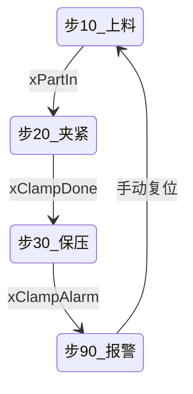

# 程序学习手册模板 📘

<!-- template-id: HBK@3.0 -->

> 文档类型：handbook | 深度：<结构深度 / 流程深度 / 代码深度>
> 讲解版式：块级
> 模板组合：HBK@3.0 [+ FB@3.0 / ST@3.0 / STATE@3.0 / INTERFACE@3.0 / FLOW@3.0，按需填写]
> 适用章节：<按本次输入列 ch1…ch10；不适用章节不列>
> 工程：<工程名> | 控制器：<型号> | 版本：<版本> | `source_sha256`：<摘要或未知>
> 覆盖对象：<任务 / POU / 工位>
> 资料范围：<导出文本 / XML / 截图> | 未覆盖：<明确列出，没有写“无”>

> 交付范围：<全项目 / 局部>
> 本次覆盖：<具体对象及源码/接口范围>
> 本次交付：<完成 / 未完成>
> 项目源码覆盖：<全覆盖 / 部分覆盖 / 无法对账>
> 用户理解：<未自测 / 已跳过 / 待验证 / 已理解>

局部成品交付规则及三种状态的定义见 `references/workflow.md`。HBK 固定章节使用 ch1…ch10；ST/FB 专题编号依各自模板，不能仅按“一、二”映射成 HBK。使用推荐专题时补共享元信息、目录和唯一锚点；不填写无关 HBK 章节。

## 目录

- [一、工程与边界](#ch1)｜[二、执行框架](#ch2)｜[三、工艺主线](#ch3)
- [四、工位地图与段分类](#ch4)｜[五、模块详解](#ch5)
- [六、段间与工位间逻辑关系](#ch6)｜[七、关键 MFB/FB](#ch7)
- [八、异常、报警与恢复](#ch8)｜[九、未确认与证据](#ch9)｜[十、理解检验与审查](#ch10)

<a id="ch1"></a>

## 一、工程与边界 📋

- 控制器与任务：<任务名、周期、类型>
- 程序组织：<按原生对象组织，如 任务 → POU → 段；工程实际存在工位时才插入工位层>
- 资料范围与缺口：<哪些对象/工位/段可读，哪些缺失或受保护>
- 本手册不覆盖：<明确列出>

<a id="ch2"></a>

## 二、执行框架 ⚙️

- 上电与首扫：<初始化内容、执行次序>
- 任务与对象调用顺序：<POU 的先后；工程实际存在工位时含工位调用顺序>
- 公共条件：<模式、使能、安全与互锁的总入口>
- 跨周期变量与保持区：<跨周期保留的状态>

### 关键变量介绍

在第一个教学源码前介绍核心变量。完整接口字典保持可追溯，不一次堆入全部变量；完整声明可放附录。

| 变量名称 | 类型／方向 | 实际含义 | 有效条件／取值 | 主要用途 |
|---|---|---|---|---|
| `<变量>` | <真实类型／方向，未知则标明> | <实际含义> | <取值及建立／清除条件> | <与控制目标的关系> |

**变量关系**：<请求与反馈、工位号与车号、结果与完成等易混淆概念>。

```text
MainTask（1ms）
→ 公共条件 POU
→ 工位 1（映射段 → 手动段 → 自动段 → 报警段）
→ 工位 2 …
```

整体功能：<整套程序的控制对象与主要输出>

<a id="ch3"></a>

## 三、工艺主线 🏭

> 以下工序、设备、步号和变量均为虚构示例，仅说明填写方式；不得作为工程事实。资料不足的字段写“未知”。

| 步 | 工序 | 进入条件 | 执行元件 | 完成信号 | 退出 | 工位/证据 |
|---|---|---|---|---|---|---|
| 10 | 上料 | <条件> | <阀/轴/输出> | <传感器> | 步 20 | W01 / M01 |
| 20 | 夹紧 | 步 10 | `yClampValve` | `xClampDone` | 步 30 | W01 / M02 |
| 30 | 保压 | 步 20 | — | `xClampDone` 保持 | 步 90 | W01 / M03 |
| 90 | 报警 | 报警位置位 | 清除输出 | 手动复位 | 步 10 | W01 / M04 |



- 图中节点必须与上表步号一一对应；新增或删除步时同步改图，不得只改一处。
- 并行步骤：<并行步骤、同步点、节拍约束>
- 手动 / 回原点 / 复位：<单独说明>
- 安全与联锁边界：<安全回路与程序互锁的分层>

<a id="ch4"></a>

## 四、工位地图与段分类 🗂️

### 4.1 工位与对象地图

| 工位/对象 | 程序单元 | 职责 | 段落构成 | 段数 | 覆盖状态 |
|---|---|---|---|---|---|
| <名称> | <POU/程序名> | <有证据的职责> | <按工程原名> | <数量/未知> | <状态> |

### 4.2 源码块覆盖清单

| 编号 | 模块/文本块 | 对象 ID / EID | 主题 | 状态 | 备注 |
|---|---|---|---|---|---|
| M01 | <段名> | &lt;ID&gt; | <职责> | 已讲 | <源码范围> |

### 4.3 实例调用点

| 区域 / 调用者 | 覆盖实例 | 来源 | 特殊配置 / 条件 |
|---|---|---|---|
| <调用段> | <实例范围> | <对象/文件> | <参数差异> |

调用条件：<调用频率、使能连接、是否重复调用及证据>。

### 4.4 接口字典

按真实接口分组，至少覆盖输入、输出/IN_OUT 与外部变量；不适用的组写明原因，不隐藏接口成员。

| 端口 / 变量 | 类型 | 方向 / 作用 | 有效条件 / 单位 | 来源 / 证据 | 证据等级 |
|---|---|---|---|---|---|
| <名称> | <类型> | <方向与用途> | <条件/单位> | <XML/源范围> | 已确认 / 推断 / 未知 |

关键结构体：<只列与控制逻辑有关的字段，并标出定义证据>。


<a id="ch5"></a>

## 五、模块详解 🔍（FB/POU 按对象选择模块）

### 对象总述

**职责**：<此 FB/POU 对外承担的控制职责；说明复用范围，不把内部模块和外部实例混为一谈>。

- 输入：<关键输入与来源>
- 输出 / IN_OUT：<关键写入与消费方>
- 调用条件：<调用者、周期、使能与调用次数>
- 控制闭环：<对象级 1 句总结，不能替代下面的模块详解>

### 模块跳转

| 模块 | 说明 |
|---|---|
| [M01 <模块名>](#m01) | <功能关键词> |
| <按每个实际模块增加一行> | <功能关键词> |

每个模块标题前放对应唯一锚点，单对象标题写 `### M01 <模块名>`；不要把标题编号链接到自身。

本章以实际学习对象为中心：先给对象总述与模块跳转；若对象覆盖多个工位实例，再按 Wxx 分组，工位分组须有对象或调用证据。单个 FB/POU 不强制套用 W01。模块编号与源码块/EID 建立映射，推断范围显式标记；覆盖清单的已讲行使用 Mxx（Bxx 原始块号保留在对象/备注），合并列出全部模块或连续区间，每个都须有对应源码正文。

### W01 <工位名>（仅多工位或需按工位组织时使用；模块标题降为 `#### M01`、五部分降为 `##### 1～5`，不得与 W01 同级）

**职责**：<该工位在工艺中的职责；不重复对象总述>

1. **进入条件：** <条件及不满足时状态>
2. **关键动作：** <主要输出/握手>
3. **时序与反馈：** <滤抖/延时/超时及反馈>
4. **完成结果：** <步序/占用/保存/放行结果>

#### W01 源码块覆盖清单

| 编号 | 模块 / 文本块 | 对象 ID / EID | 范围 | 状态 | 备注 |
|---|---|---|---|---|---|
| M01 | <名称> | &lt;ID&gt; | <范围> | 已讲 | <证据/缺口> |

模块跳转表按实际模块完整列出；每个模块标题前放唯一锚点，模块标题本身不链接自身编号。

<!-- 多工位时模块与五部分按父级整体降一级：`#### M01`、`##### 1～5`。下文以单对象骨架（`### M01` / `#### 1～5`）书写，放入 W01 组时整体降一级。 -->
<!-- 以下逻辑单元反复使用简约五部分；标题表情与局部样式一致。 -->
**关键变量前置：每个逻辑单元**在自己的模块标题之前放六列变量表，不以全局接口表代替。

| 变量 | 数据类型 | 方向 | 含义 | 谁写谁读 | 证据等级 |
|---|---|---|---|---|---|
| `<完整变量路径>` | <声明类型/数组范围；缺声明填未知> | <声明方向> | <短语；命名推断标明> | <可回查读写点> | <已确认/推断/未知> |

<a id="m01"></a>

### M01 <模块名> 🔍

**一句话说清**：<本段做什么，短句，不重复定位>。

#### 1. 功能定位与执行条件

**功能定位**：<本段在整体流程的位置、前置结果和后续用途>。

**代码职责**：<本段要解决的问题与处理动作>。

**设计依据**：<从已给目标与可见事实推出所需行为，再对应条件/状态；目标缺证据则标未知或条件假设，不冒充原作者意图，不把现有实现当唯一正确方案>。

**本段关键变量**：<已在本单元前置六列表中介绍，这里只在有差异时补一句，不再重复列表>。

| 进入条件 | 必要原因 | 不满足时的行为 |
|---|---|---|
| `<条件>` | <由控制目标与事实推出必要性> | <跳过／其他分支／保持原值> |

#### 2. 源码

**来源定位**：<文件路径、XML对象或真实行号；缺坐标写none并注明限制>。

**展示方式**：教学注释版；每小段后紧邻整体说明，第一性原理不单列理论标题。仅追加贴合上下文、有理解价值的行内注释。简单赋值、变量声明、调用、条件续行与分支逐项核对；执行行缺解释必须补齐或明确交付未完成。原字符与原注释保留，不用正文替代行内覆盖；逐块语义审查见 `references/comment-quality.md`。

<!-- src: 起-止；来源/对象：<文件路径、XML 路径、对象 ID 或其他可定位证据> -->

```text
<教学注释版源码占位；成稿改成实际PLC标签。按完整逻辑小段展示，不按行数硬切，不拆闭合结构或块注释。>
```

#### 3. 代码块整体讲解

**处理过程**：<输入是什么→经过什么判断→得到什么结果；数据流清楚，禁止只写"执行判断">。

**关键逻辑**：<在明确事实与假设下，保留其他因素只删改一个条件/状态/顺序，给具体输入与结果差异；若无差异、条件冗余或存在缺陷如实说明，不预设当前写法必要>。

**写法好处**：<有证据的局部收益、取舍与代价；不足以比较时写“本片段不足以确认比较优势”，不凭局部证明单写入、扫描无关或整机安全>。

**状态变化**：<哪些变量本次写入/不写；跨调用保持先给存储与其他写入假设。复位方有实际写入证据才定位；逐项列已见清除及条件，只对未见路径写“实际清除点未知”；本段确实没有 FALSE 写入时才说未见，不保证别处存在复位>。

**易混淆点（按需）**：<同一需求和输入下比较原版与单因素改版，说明行为差异和适用边界；未给需求不把不同方案一概标成错误/正确>。

#### 4. 形象示例

**场景设定**：<真实变量名，说明在什么情况下看这段行为>。

**初始状态**：<输入序列与具体变量名+初值，如 `xRequest=FALSE`；在使用前声明存储、同实例、无其他写入及定时器行为假设；每次承接前次后值，跨时跳跃明确经过时间，不编造任务周期>。

| 阶段／执行 | 输入与原状态 | 本段处理 | 执行结果 |
|---|---|---|---|
| 第1次执行 | <具体初值与输入> | <实际路径> | <具体后值> |
| 第2次执行 | <承接前次后值，改变一个输入> | <实际路径> | <变化或本次不写> |
| 第3次执行 | <承接前值；涉及时间写明间隔> | <实际路径> | <结果与边界> |

**理解要点**：<例子说明了什么关键因果；不说“变量变化了”，要说“为什么这样变化”>。

**形象类比（可选）**：<帮助理解的类比及不适用边界；无帮助则省略>。

#### 5. 程序交互与段间交接

| 关系 | 来源 | 目标 | 关联变量 | 实际作用 |
|---|---|---|---|---|
| 输入 | <程序／对象> | 本段 | `<变量>` | <提供的前提> |
| 输出 | 本段 | <程序／对象／未知> | `<变量>` | <后续用途> |

**交接要点**：<时机、保持要求或丢失后果；无证据标未知，同程序内部段间关系不称跨程序调用>。

**下一段承接**：<当前结果与下一段的关系；仅相邻阅读单元则注明>。

（按此结构继续 M02、M03……直到清单中全部 `已讲` 的模块）

<a id="ch6"></a>

## 六、段间与工位间逻辑关系 🔗

| 类型 | 来源 | 目标 | 变量/状态 | 时机 | 丢失或乱序后果 | 证据 |
|---|---|---|---|---|---|---|
| 数据 | W01 / M03 | W01 / M05 | `xClampDone` | 同周期 | M05 读取旧值，等待超时 | 网络 41 |
| 互锁 | W01 / M04 | W02 / M02 | `xAllowIn` | 跨周期 | 工位 2 不动作 | 网络 88 |

补充：

- 多处写入的变量：<全部写入点与执行先后>
- 跨工位 / 跨任务信号：<映射变量、共享变量、通讯缓冲区>
- 断点与孤立变量：<有写无读、有读无写>

<a id="ch7"></a>

## 七、关键 MFB/FB 🧩（存在相关对象时填写）

| 功能块定义 | 实例 | 调用者 | 可见职责 / 输出去向 | 本体可见性 | 证据 |
|---|---|---|---|---|---|
| <原始对象名/ID> | <实例名> | <任务/POU/段> | <只写外部可见事实> | 完整 / 部分 / 受保护 / 未提供 | <位置> |

本章只登记关键对象与可见调用；接口成员、实例参数差异和内部实现改用 `FB` / `INTERFACE` 专题，不在此重复定义。

<a id="ch8"></a>

## 八、异常、报警与恢复 🚨

| 报警码 | 报警 / 异常 | 触发条件 | 影响对象 | 输出处理 | 复位方式 | 恢复起点 | 证据 |
|---|---|---|---|---|---|---|---|
| AL-01 | <报警名> | <条件> | W01 / M02–M04 | <清除的输出> | <手动/自动> | <步号> | <位置> |

- 报警码无工程原件时按 `AL-01` 顺序自编，并在“未确认”章注明规则。
- 复位方式必须区分：自动复位、手动复位、断电复位；恢复起点写步号而非“从头开始”。

<a id="ch9"></a>

## 九、未确认与证据 ❓

| 项 | 现状 | 依据 | 需确认内容 |
|---|---|---|---|
| <缺口> | 未知 | <位置> | <需要核对的资料/问题> |

<a id="ch10"></a>

## 十、理解检验与审查 🧪

理解检验（可选）：<用户愿意时给 3～5 个问题，使用本工程变量与状态；未自测不影响本次文档交付，不登记已理解>。

文档审查：<源代码覆盖、调用点、接口、锚点、证据等级与未确认项；全部 PLC 块的逐行注释覆盖和逐块语义审查记录路径，未审查/有错明确标出>。

使用说明：仅保留本输入适用的章节；`适用章节` 元信息列出的每一章都必须出现且按 ch1–ch10 规范顺序排列，允许省略不适用章。专题文档可只取共享字段和相关专题，不能为了章节编号补写无依据内容。

弱模型单任务骨架：填写元信息与证据边界，声明适用章节，然后按本模板顺序复制这些章节；模块详解中的每个 Mxx 使用五部分分级标题：功能定位与执行条件、源码、代码块整体讲解、形象示例、程序交互与段间交接；不另建正文逐行复述。

**长闭合结构规则：** 按 `references/code-reading.md` 的“核心原则：一次只讲一小段”执行；本模板保留源码一次，并用源码锚点和源行号范围解释分支，完整性门禁拒绝重复、改写和漏行。

局部成品需增加 `## 范围外缺口`，列对象、原因、对理解的影响及所需资料；不得将声明范围内的漏讲移入该节以声称完成。全项目文档不得借此忽略保护块或未覆盖内容。
