# 状态机与步序专题模板 🔄
<!-- template-id: STATE@3.0 -->

适用组合：`HBK@3.0 + STATE@3.0`，可再组合 `FB`、`ST`、`INTERFACE` 或 `FLOW`。共用工程元信息、证据等级、源码范围、覆盖状态和交接字段遵循 `template-handbook.md`，本专题只定义状态转移数据。

所讲解教学源码（若包含状态条件或分支片段）遵循 `references/comment-quality.md`：尽量逐行附贴合上下文的行内解释，执行行缺解释须补齐或标明未完成，仅纯闭合行可登记省略理由，并逐块语义审查，不用图前概述替代。

````markdown
# 状态机专题：<对象 / 状态机名称>

> 模板组合：HBK@3.0 + STATE@3.0
> 适用范围：<任务/POU/状态机；只列有证据的部分>
> 来源：<文件、对象 ID/EID、网络或行范围>
> 未知或未覆盖：<缺少的定义、调用者、分支或复位路径>

## 状态与转移

| 当前状态 | 进入证据 | 转移条件 | 动作 / 输出 | 下一状态 | 退出/复位路径 | 证据等级 |
|---|---|---|---|---|---|---|
| <状态/步号> | <来源条件> | <布尔条件或事件> | <可见动作> | <目标状态> | <条件；未知则标明> | 已确认 / 推断 / 未知 |

## 状态图

```mermaid
stateDiagram-v2
    <状态A> --> <状态B>: <有源码依据的条件>
```



## 等待、超时与复位

| 等待状态 | 等待条件 | 超时/异常证据 | 输出保持或清除 | 恢复起点 | 证据 |
|---|---|---|---|---|---|
| <状态> | <反馈/握手> | <定时器/未发现> | <源码可见行为> | <状态或未知> | <位置> |

## 未确认项

- <缺失的分支、状态值、调用顺序或反馈来源；源码片段的注释语义审查记录；说明最小需要的资料>
````

使用规则：图只呈现已登记转移；不把未显示边解释为不可达。没有状态机证据时跳过本专题，不把程序段顺序臆造成状态转移。安全回路与普通程序互锁分开标注。
